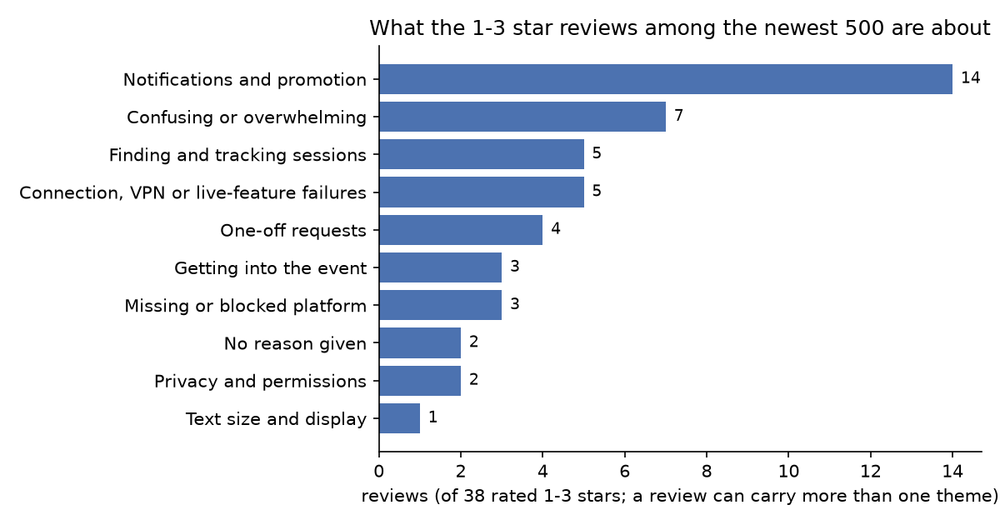

# whova-review-study

What attendees complain about when they give the Whova event app one to three stars on the US App
Store, read from the 500 newest reviews, and the study I would run next with Whova's own data. I am not
affiliated with Whova; everything here comes from Apple's public review feed.

The 500 reviews run from 16 September 2025 to 27 October 2026, and most of them are happy: 436 give
five stars, 26 give four, and 38 give one to three. I read all 38 low ratings and coded each one by
hand against the codebook in [review_study/themes.py](review_study/themes.py). A review can carry more
than one theme, so the counts below add up to more than 38.



| theme | reviews (of 38) |
|---|---|
| Notifications and promotion | 14 |
| Confusing or overwhelming, no feature named | 7 |
| Finding and tracking sessions | 5 |
| Connection, VPN or live-feature failures | 5 |
| One-off requests | 4 |
| Getting into the event | 3 |
| Missing or blocked platform (macOS, web on iPad) | 3 |
| Privacy and permissions | 2 |
| No reason given | 2 |
| Text size and display | 1 |

An interactive version of the charts, with reviews per month, is in [docs/index.html](docs/index.html).

## What the low ratings say

- **Notifications are the largest group, 14 of 38.** In 7 of the 14 the reviewer says the unwanted
  messages come from Whova itself: tips on how to use the app, promotion of the app, marketing emails
  and, in one case, phone calls. Four of those seven say they could not turn them off, and two say they
  wanted to keep the conference's own notifications and lose only Whova's. The other 7 do not say who
  sent the messages; one of them got alerts at 5 AM and on weekends. Whova's FAQ says attendees can
  turn each notification type for the event, the community board and topics on or off, so the
  complaint is about the messages that are not in that list, or that people do not find there.
- **The next usability complaint is about the agenda, 5 of 38.** The schedule is one option on the
  bottom row, below 12 others; past sessions cannot be filtered out; filters reset; a talk cannot be
  checked off; and only one session per time slot can be saved.
- **Seven more find the app confusing or overwhelming without naming a feature**, and five hit a
  connection problem, three of them behind a VPN or after an update.

## What this can and cannot tell you

These are the people who chose to write a review, so the counts say what was said, not how common each
problem is among attendees. Thirty-eight reviews is a small set: one reviewer more or less moves a
theme's share by about 3 percentage points. The codes are one
reader's (mine), and the reason for each is in the `summary` column of
[data/codes.csv](data/codes.csv), written in my words so you can disagree with a specific call.

## What I would study next, with Whova's data

1. **Time to the agenda.** How long attendees take from opening the app to their first session page,
   and whether it grows with the number of options the event's app shows before the schedule. The
   review that counted 12 options above it is one data point; event logs would show whether it is a
   pattern.
2. **Who turns notifications off.** Whether attendees who receive more of Whova's own messages are more
   likely to switch notifications off altogether. If they are, the platform messages also cost the
   organizer's announcements their reach, which is the cost an organizer would care about.

## How to run it

```
python -m venv .venv
.venv/Scripts/activate        # on macOS or Linux: source .venv/bin/activate
pip install -r requirements.txt
python scripts/analyze.py     # rebuilds results/summary.json and the charts from data/
python -m pytest
```

`python scripts/fetch_reviews.py` downloads the newest reviews again. Apple serves only the newest 500,
so a later fetch returns a different set, and the hand codes in `data/codes.csv` cover the set fetched
on 2026-10-29 (UTC). The analysis refuses to run if any review rated one to three stars is missing a
code, has two, or has a rating that differs from the feed.

| file | what it holds |
|---|---|
| `scripts/fetch_reviews.py` | downloads the 10 feed pages; writes `data/reviews.csv` and `data/MANIFEST.json` (fetch time, counts, a SHA-256 of every page) |
| `data/reviews.csv` | one row per review: id, date, app version, rating, and the word counts of title and text |
| `data/codes.csv` | my codes for the 38 reviews rated one to three stars, with a one-line paraphrase of each |
| `review_study/themes.py` | the codebook and the checks that every code uses it and covers every low rating once |
| `scripts/analyze.py` | every number in this README, written to `results/summary.json`, and the charts |

The repository stores no review text and no reviewer nicknames. The pages as served, and a reading copy
of the 38 low ratings, go to `data/raw/`, which git ignores.
